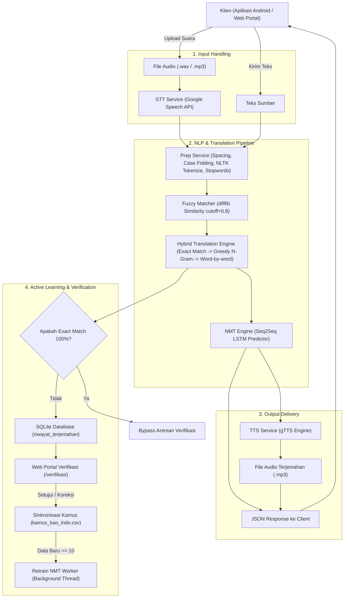

# Dokumentasi Sistem Backend & Spesifikasi API
## Sistem Penerjemah Bahasa Kao (Pagu, Modole, Towiliko) - Bahasa Indonesia

Dokumen ini berisi rangkuman komprehensif mengenai arsitektur sistem, alur pemrosesan data (*pipeline*), skema basis data, dan dokumentasi lengkap seluruh REST API pada backend sistem penerjemah multi-dialek Bahasa Kao - Indonesia.

---

## 1. Gambaran Umum Sistem

Backend ini dibangun menggunakan kerangka kerja **FastAPI** (Python 3.12) dengan arsitektur modular yang menggabungkan:
- **Speech-to-Text (STT)** menggunakan Google Speech Recognition API.
- **Natural Language Preprocessing (NLP)** menggunakan NLTK dan Regular Expression.
- **Koreksi Ejaan Otomatis (*Fuzzy Matching*)** menggunakan algoritma *Gestalt Pattern Matching* (`difflib`).
- **Penerjemahan Hibrida (*Hybrid Translation*)**:
  1. *Exact Sentence Match* (Pencocokan 100% tingkat kalimat).
  2. *Greedy Longest N-Gram Match* (Pencocokan tingkat frasa/kumpulan kata terpanjang hingga 16 kata).
  3. *Word-by-word Match* (Pencocokan kata tunggal).
- **Neural Machine Translation (NMT)** berbasis Deep Learning *Sequence-to-Sequence* (Encoder-Decoder LSTM) dengan TensorFlow/Keras.
- **Text-to-Speech (TTS)** menggunakan Google Text-to-Speech (`gTTS`).
- **Human-in-the-Loop Active Learning**: Antrean verifikasi berbasis SQLite dan web portal interaktif untuk penutur lokal/admin memvalidasi dan mengoreksi hasil terjemahan, yang secara otomatis menyinkronkan data ke kamus CSV dan memicu pelatihan ulang (*retraining*) model.

### Struktur Direktori

```text
backend/
├── main.py                     # Entry point FastAPI & seluruh rute endpoint
├── train.py                    # Script pelatihan model NMT mandiri (Keras LSTM)
├── dataset_mentah.csv          # Dataset mentah pasangan kata/kalimat
├── catatan.txt                 # Panduan integrasi client Android (Retrofit)
├── data/
│   ├── kamus_kao_indo.csv      # Dataset kamus utama (INDONESIA, PAGU, MODOLE, TOWILIKO)
│   └── terjemahan.db           # SQLite database untuk riwayat & antrean verifikasi
├── ml/
│   └── models/
│       └── nmt_model.h5        # Bobot model Seq2Seq LSTM hasil pelatihan
├── services/
│   ├── db_service.py           # Operasi database SQLite riwayat & verifikasi
│   ├── hybrid_service.py       # Logika koreksi fuzzy & hybrid translation
│   ├── model_updater.py        # Sinkronisasi CSV & background retraining worker
│   ├── nmt_service.py          # Loader & inferensi model NMT
│   ├── prep_service.py         # Pipeline NLP (spacing, tokenization, filtering)
│   ├── stt_service.py          # Speech-to-Text Google Recognizer
│   └── tts_service.py          # Text-to-Speech generator (gTTS)
└── static/
    ├── verifikasi.html         # Web UI portal verifikasi penutur lokal
    ├── audio_input/            # Direktori sementara file audio dari pengguna
    └── audio_output/           # Direktori file audio hasil terjemahan (TTS)
```

---

## 2. Arsitektur & Alur Pemrosesan (*Pipeline*)

### Diagram Alur Sistem



---

### Penjelasan Rinci Tiap Modul Pemrosesan

#### A. Speech-to-Text (STT) — [`services/stt_service.py`](file:///g:/kerjaan%20joki%20skripsi/backend/services/stt_service.py)
- **Fungsi**: [`recognize_speech()`](file:///g:/kerjaan%20joki%20skripsi/backend/services/stt_service.py#L3-L28).
- **Mekanisme**: Membaca file audio yang diunggah ke `static/audio_input/`, mengubahnya menjadi data audio digital menggunakan pustaka `SpeechRecognition`, lalu mengirimkannya ke Google Speech API dengan kode bahasa `id-ID`. Jika suara tidak jelas atau hening (*silence*), fungsi mengembalikan string kosong yang kemudian memicu respons HTTP `400 Bad Request`.

#### B. Text Preprocessing — [`services/prep_service.py`](file:///g:/kerjaan%20joki%20skripsi/backend/services/prep_service.py)
- **Fungsi**: [`preprocess_text()`](file:///g:/kerjaan%20joki%20skripsi/backend/services/prep_service.py#L15-L43).
- **Langkah-langkah**:
  1. **Spacing**: Menyelipkan spasi antara karakter huruf dan tanda baca yang menempel untuk memisahkan kata secara bersih (Regex: `(?<=[a-zA-Z])(?=[.,!?])|(?<=[.,!?])(?=[a-zA-Z])`).
  2. **Case Folding / Normalisasi**: Mengubah seluruh karakter menjadi huruf kecil (*lowercase*).
  3. **Tokenisasi**: Memecah kalimat menjadi daftar unit kata (*tokens*) menggunakan NLTK `word_tokenize` (dengan *fallback* Regex kata jika resource NLTK tidak tersedia).
  4. **Filtering**: Menghilangkan tanda baca terisolasi dan kata interjeksi/pengisi (*filler words*) seperti `aduh`, `eh`, `em`, `hmm`.

#### C. Koreksi Ejaan Fuzzy — [`services/hybrid_service.py`](file:///g:/kerjaan%20joki%20skripsi/backend/services/hybrid_service.py)
- **Fungsi**: [`koreksi_fuzzy()`](file:///g:/kerjaan%20joki%20skripsi/backend/services/hybrid_service.py#L104-L166).
- **Mekanisme**:
  - Mengatasi kesalahan ucapan dari STT (*misheard words*) atau salah ketik (*typo*) dari pengguna.
  - Membandingkan token dengan daftar entri kamus menggunakan `difflib.get_close_matches` dengan ambang kemiripan (*similarity cutoff*) sebesar `0.8` (80%).
  - Dilakukan secara bertingkat: pertama mencocokkan seluruh kalimat, jika tidak ada kecocokan tinggi maka dicocokkan per kata.

#### D. Hybrid Translation Engine — [`services/hybrid_service.py`](file:///g:/kerjaan%20joki%20skripsi/backend/services/hybrid_service.py)
- **Fungsi**: [`translate_hybrid()`](file:///g:/kerjaan%20joki%20skripsi/backend/services/hybrid_service.py#L210-L308).
- **Hierarki Penerjemahan**:
  - **Tingkat 1 (*Exact Match*)**: Memeriksa apakah satu kalimat penuh cocok 100% di hash map kamus. Jika cocok, langsung mengembalikan arti kalimat tersebut.
  - **Tingkat 2 (*Greedy Longest N-Gram Matching*)**: Jika kalimat utuh tidak ada di kamus, mesin memeriksa kombinasi frasa terpanjang (hingga 16 kata) secara mundur (*top-down*). Contoh frasa idiomatis seperti *"air putih"* atau *"selamat pagi"* akan diterjemahkan sebagai satu kesatuan frasa, bukan diterjemahkan per kata secara terpisah.
  - **Tingkat 3 (*Word-by-word Translation*)**: Kata tunggal yang tersisa dicari padanannya di kamus. Jika suatu kata tidak terdaftar di kamus, kata tersebut dipertahankan dalam bentuk aslinya (*out-of-vocabulary fallback*).

#### E. Neural Machine Translation (NMT) — [`services/nmt_service.py`](file:///g:/kerjaan%20joki%20skripsi/backend/services/nmt_service.py) & [`train.py`](file:///g:/kerjaan%20joki%20skripsi/backend/train.py)
- **Arsitektur Model**:
  - **Encoder**: *Embedding layer* (dimensi 256) diikuti oleh LSTM layer (512 unit) yang mengembalikan vektor status (*hidden state* $h$ dan *cell state* $c$).
  - **Decoder**: *Embedding layer* (dimensi 256) diikuti oleh LSTM layer (512 unit) yang diinisialisasi dengan status akhir dari Encoder, diproyeksikan ke *Dense Softmax layer* seukuran ukuran kosakata target.
- **Fungsi Inferensi**: [`translate_nmt()`](file:///g:/kerjaan%20joki%20skripsi/backend/services/nmt_service.py#L31-L44) bertugas menghaluskan susunan kalimat bahasa target agar lebih alami.

#### F. Text-to-Speech (TTS) — [`services/tts_service.py`](file:///g:/kerjaan%20joki%20skripsi/backend/services/tts_service.py)
- **Fungsi**: [`generate_audio()`](file:///g:/kerjaan%20joki%20skripsi/backend/services/tts_service.py#L3-L14).
- **Mekanisme**: Menerima teks hasil akhir terjemahan, lalu menyintesisnya menjadi file audio berekstensi `.mp3` menggunakan pustaka `gTTS` dan menyimpannya di folder `static/audio_output/` sehingga dapat diunduh/diputar oleh aplikasi Android.

#### G. Siklus Verifikasi & Pembaruan Otomatis — [`services/model_updater.py`](file:///g:/kerjaan%20joki%20skripsi/backend/services/model_updater.py)
- Terjemahan baru yang dihasilkan oleh sistem otomatis dicatat ke SQLite dengan status `menunggu`.
- Penutur asli meninjau entri terjemahan melalui web portal `/verifikasi`.
- Saat entri diberi status `terverifikasi` (dengan opsi koreksi kalimat jika terjemahan mesin kurang tepat):
  1. Data baru dimasukkan ke [`data/kamus_kao_indo.csv`](file:///g:/kerjaan%20joki%20skripsi/backend/data/kamus_kao_indo.csv).
  2. Kamus di RAM dimuat ulang seketika melalui [`load_kamus()`](file:///g:/kerjaan%20joki%20skripsi/backend/services/hybrid_service.py#L40-L96).
  3. Sistem menghitung akumulasi data terverifikasi yang belum dilatih. Jika sudah mencapai $\ge 10$ baris, sistem secara otomatis mengeksekusi pelatihan ulang model NMT di latar belakang (*background thread*).

---

## 3. Spesifikasi Lengkap REST API

Base URL server lokal: `http://localhost:8000` atau IP jaringan lokal `http://<IP_KOMPUTER>:8000`.

### Daftar Endpoint

| No | Method | Path | Deskripsi | Autentikasi |
|:---|:---|:---|:---|:---|
| 1 | `POST` | `/api/v1/translate/audio` | Menerjemahkan input file suara | Publik |
| 2 | `POST` | `/api/translate` | Menerjemahkan input teks ketikan | Publik |
| 3 | `GET` | `/api/v1/verifikasi/list` | Mendapatkan daftar antrean terjemahan | Publik / Admin |
| 4 | `GET` | `/api/v1/verifikasi/stats` | Mendapatkan ringkasan statistik verifikasi | Publik / Admin |
| 5 | `POST` | `/api/v1/verifikasi/{item_id}/proses` | Memproses verifikasi (Setujui/Tolak/Koreksi) | Publik / Admin |
| 6 | `DELETE`| `/api/v1/verifikasi/{item_id}` | Menghapus riwayat terjemahan | Publik / Admin |
| 7 | `POST` | `/api/v1/model/sinkronkan` | Sinkronisasi data terverifikasi ke CSV kamus | Publik / Admin |
| 8 | `POST` | `/api/v1/model/retrain` | Memicu pelatihan ulang model NMT (async) | Publik / Admin |
| 9 | `GET` | `/api/v1/model/status` | Mengecek status live pelatihan model NMT | Publik / Admin |
| 10 | `GET` | `/verifikasi` | Tampilan Web Portal Verifikasi Penutur Lokal | Browser |
| 11 | `GET` | `/` | Cek status kesehatan server (*health check*) | Publik |

---

### Rincian Endpoint

### 1. Terjemahan Suara (Audio)
- **URL**: `POST /api/v1/translate/audio`
- **Content-Type**: `multipart/form-data`
- **Parameter Form**:
  - `audio_file` (*Binary / File*, Wajib): File rekaman audio (format `.wav`, `.mp3`, `.m4a`).
  - `arah_terjemahan` (*String*, Wajib): Pilihan arah terjemahan:
    - `"indo_ke_kao"` (Default ke dialek Pagu)
    - `"indonesia_ke_pagu"`
    - `"indonesia_ke_modole"`
    - `"indonesia_ke_towiliko"`
    - `"kao_ke_indo"`

#### Contoh Request cURL:
```bash
curl -X POST "http://localhost:8000/api/v1/translate/audio" \
  -F "audio_file=@rekaman_suara.wav" \
  -F "arah_terjemahan=indonesia_ke_pagu"
```

#### Contoh Response Sukses (`200 OK`):
```json
{
  "status": "success",
  "teks_asli": "selamat pagi",
  "teks_sumber_dikenali": "selamat pagi",
  "teks_terjemahan": "olo siado",
  "teks_terjemahan_akhir": "olo siado",
  "url_audio_hasil": "/static/audio_output/translated_rekaman_suara.wav.mp3"
}
```

#### Respons Error:
- `400 Bad Request`: Suara hening atau tidak terdeteksi oleh STT.
  ```json
  {
    "status": "error",
    "message": "Suara tidak berhasil dikenali. Silakan coba rekam kembali dengan lebih jelas."
  }
  ```
- `500 Internal Server Error`: Terjadi kegagalan pemrosesan di server.

---

### 2. Terjemahan Teks
- **URL**: `POST /api/translate`
- **Content-Type**: `application/json` ATAU `application/x-www-form-urlencoded`
- **Parameter**:
  - `teks_sumber` / `teks` / `text` (*String*, Wajib): Teks yang ingin diterjemahkan.
  - `arah_terjemahan` / `bahasa_tujuan` (*String*, Opsional, Default: `"indo_ke_kao"`).

#### Contoh Request cURL (JSON):
```bash
curl -X POST "http://localhost:8000/api/translate" \
  -H "Content-Type: application/json" \
  -d '{
    "teks_sumber": "apa kabar",
    "arah_terjemahan": "indonesia_ke_pagu"
  }'
```

#### Contoh Response Sukses (`200 OK`):
```json
{
  "status": "success",
  "teks_asli": "apa kabar",
  "teks_sumber_dikenali": "apa kabar",
  "teks_terjemahan": "olo siado",
  "teks_terjemahan_akhir": "olo siado"
}
```

---

### 3. Daftar Antrean Verifikasi
- **URL**: `GET /api/v1/verifikasi/list`
- **Query Parameters**:
  - `status` (*String*, Default: `"menunggu"`): Filter status (`"menunggu"`, `"terverifikasi"`, `"ditolak"`, `"semua"`).
  - `dialek` (*String*, Default: `"semua"`): Filter dialek (`"PAGU"`, `"MODOLE"`, `"TOWILIKO"`, `"semua"`).
  - `q` (*String*, Default: `""`): Kata kunci pencarian.
  - `limit` (*Integer*, Default: `100`): Jumlah data per halaman.
  - `offset` (*Integer*, Default: `0`): Offset data.

#### Contoh Response Sukses (`200 OK`):
```json
{
  "status": "success",
  "total": 1,
  "data": [
    {
      "id": 12,
      "teks_sumber": "makan nasi",
      "teks_terjemahan": "oyomo inahu",
      "arah_terjemahan": "indonesia_ke_pagu",
      "dialek": "PAGU",
      "sumber_input": "teks",
      "status": "menunggu",
      "teks_koreksi": null,
      "penutur_lokal": null,
      "catatan": null,
      "disinkronkan_ke_model": 0,
      "dilatih_ke_model": 0,
      "waktu_dibuat": "2026-10-14 01:10:00",
      "waktu_verifikasi": null
    }
  ],
  "stats": {
    "total": 21,
    "menunggu": 15,
    "terverifikasi": 4,
    "ditolak": 2,
    "belum_sinkron": 0
  }
}
```

---

### 4. Statistik Ringkasan Verifikasi
- **URL**: `GET /api/v1/verifikasi/stats`

#### Contoh Response Sukses (`200 OK`):
```json
{
  "status": "success",
  "data": {
    "total": 21,
    "menunggu": 15,
    "terverifikasi": 4,
    "ditolak": 2,
    "belum_sinkron": 0
  }
}
```

---

### 5. Proses Verifikasi Terjemahan
- **URL**: `POST /api/v1/verifikasi/{item_id}/proses`
- **Path Parameter**: `item_id` (*Integer*, Wajib) - ID riwayat terjemahan.
- **Request Body (JSON / Form Data)**:
  - `status` (*String*, Default: `"terverifikasi"`): `"terverifikasi"` atau `"ditolak"`.
  - `teks_koreksi` (*String*, Opsional): Teks perbaikan dari penutur lokal jika mesin salah menerjemahkan.
  - `penutur_lokal` (*String*, Opsional): Nama penutur lokal atau admin yang memverifikasi.
  - `catatan` (*String*, Opsional): Catatan dialek atau tata bahasa.
  - `sinkron_sekarang` (*Boolean*, Default: `true`): Langsung menyinkronkan data ke CSV kamus.

#### Contoh Request cURL:
```bash
curl -X POST "http://localhost:8000/api/v1/verifikasi/12/proses" \
  -H "Content-Type: application/json" \
  -d '{
    "status": "terverifikasi",
    "teks_koreksi": "oyomo inahu",
    "penutur_lokal": "Tetua Adat Pagu",
    "catatan": "Sesuai dialek asli",
    "sinkron_sekarang": true
  }'
```

#### Contoh Response Sukses (`200 OK`):
```json
{
  "status": "success",
  "message": "Item ID 12 berhasil diproses dengan status 'terverifikasi'.",
  "item": {
    "id": 12,
    "status": "terverifikasi",
    "teks_koreksi": "oyomo inahu",
    "penutur_lokal": "Tetua Adat Pagu"
  },
  "sync_result": {
    "status": "success",
    "synced_count": 1,
    "total_entri_kamus": 1106
  },
  "auto_train_triggered": false
}
```

---

### 6. Hapus Riwayat Verifikasi
- **URL**: `DELETE /api/v1/verifikasi/{item_id}`
- **Path Parameter**: `item_id` (*Integer*, Wajib).

#### Contoh Response Sukses (`200 OK`):
```json
{
  "status": "success",
  "message": "Item ID 12 berhasil dihapus."
}
```

---

### 7. Sinkronisasi Manual ke Kamus CSV
- **URL**: `POST /api/v1/model/sinkronkan`
- **Deskripsi**: Menyinkronkan seluruh entri yang sudah berstatus `terverifikasi` namun belum masuk ke file `data/kamus_kao_indo.csv`, serta me-reload kamus pada memori server secara *real-time*.

#### Contoh Response Sukses (`200 OK`):
```json
{
  "status": "success",
  "message": "3 data terverifikasi berhasil dimasukkan ke kamus dan memori diperbarui.",
  "synced_count": 3,
  "total_entri_kamus": 1108
}
```

---

### 8. Pelatihan Ulang Model NMT (*Retrain*)
- **URL**: `POST /api/v1/model/retrain`
- **Deskripsi**: Menjalankan proses *fine-tuning* / *retraining* model NMT LSTM di *background thread* tanpa menghentikan atau memperlambat respons server FastAPI.
- **Request Body (JSON, Opsional)**:
  - `epochs` (*Integer*, Default: `30`)
  - `batch_size` (*Integer*, Default: `64`)

#### Contoh Response Sukses (`200 OK`):
```json
{
  "status": "started",
  "message": "Pelatihan model NMT (30 epoch) berhasil dimulai di background.",
  "data": {
    "is_training": true,
    "progress": "Membaca dataset kamus...",
    "last_trained": null,
    "error": null,
    "total_samples": 3324,
    "epoch_info": ""
  }
}
```

---

### 9. Cek Status Pelatihan Model NMT
- **URL**: `GET /api/v1/model/status`
- **Deskripsi**: Memantau status terkini dari pelatihan model NMT yang sedang berjalan.

#### Contoh Response Sukses (`200 OK`):
```json
{
  "status": "success",
  "data": {
    "is_training": false,
    "progress": "Selesai",
    "last_trained": "2026-10-14 01:15:30",
    "error": null,
    "total_samples": 3324,
    "epoch_info": "Epoch 30/30 - loss: 0.0842 - acc: 0.9781"
  }
}
```

---

### 10. Web Portal Verifikasi & Root
- **`GET /verifikasi`**: Menampilkan web portal antarmuka verifikasi HTML/Tailwind CSS yang terhubung langsung ke seluruh API verifikasi.
- **`GET /`**: Mengembalikan info status server dan tautan dokumentasi OpenAPI Swagger UI di `/docs`.

---

## 4. Skema Basis Data SQLite (`data/terjemahan.db`)

Tabel utama: `riwayat_terjemahan`

| Nama Kolom | Tipe Data | Keterangan |
|:---|:---|:---|
| `id` | `INTEGER PRIMARY KEY AUTOINCREMENT` | ID unik entri |
| `teks_sumber` | `TEXT NOT NULL` | Kalimat input dari pengguna |
| `teks_terjemahan` | `TEXT NOT NULL` | Hasil terjemahan yang dihasilkan sistem |
| `arah_terjemahan` | `TEXT NOT NULL` | Arah penerjemahan (contoh: `indonesia_ke_pagu`) |
| `dialek` | `TEXT DEFAULT 'PAGU'` | Dialek target (`PAGU`, `MODOLE`, `TOWILIKO`) |
| `sumber_input` | `TEXT DEFAULT 'teks'` | Jenis input: `'teks'` atau `'audio'` |
| `status` | `TEXT DEFAULT 'menunggu'` | Status: `'menunggu'`, `'terverifikasi'`, `'ditolak'` |
| `teks_koreksi` | `TEXT` | Kalimat perbaikan dari penutur asli |
| `penutur_lokal` | `TEXT` | Nama verifikator / penutur asli yang memvalidasi |
| `catatan` | `TEXT` | Catatan tambahan linguistik/budaya |
| `disinkronkan_ke_model` | `INTEGER DEFAULT 0` | Flag (1 jika sudah dicatat ke file CSV kamus) |
| `dilatih_ke_model` | `INTEGER DEFAULT 0` | Flag (1 jika sudah diikutsertakan dalam training NMT) |
| `waktu_dibuat` | `TIMESTAMP DEFAULT CURRENT_TIMESTAMP` | Waktu terjemahan dilakukan |
| `waktu_verifikasi` | `TIMESTAMP` | Waktu diverifikasi oleh penutur lokal |

---

## 5. Panduan Menjalankan Server Backend

### 1. Menjalankan Server Lokal
Pastikan *environment* Python aktif, lalu jalankan:
```bash
uvicorn main:app --host 0.0.0.0 --port 8000 --reload
```
Server akan dapat diakses dari:
- **Dokumentasi Interaktif (Swagger UI)**: `http://localhost:8000/docs`
- **Portal Verifikasi**: `http://localhost:8000/verifikasi`
- **Akses Klien Android**: `http://<IP_KOMPUTER_WIFI>:8000` (misal: `http://192.168.0.102:8000`)

